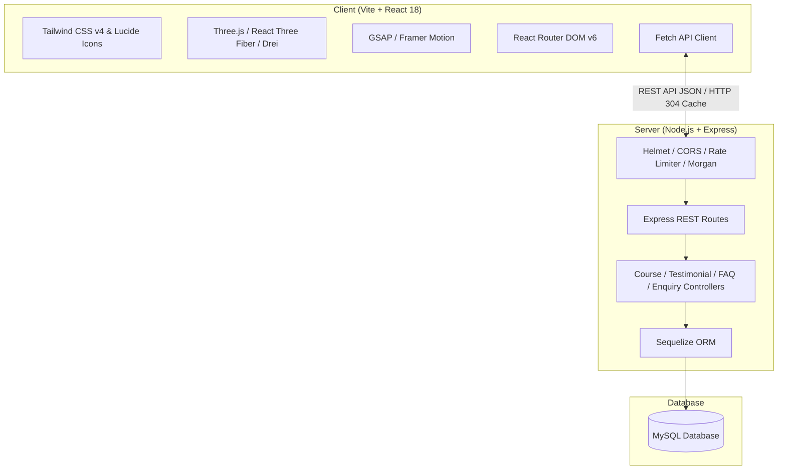

# 🛡️ NERDS LAB 3D — Immersive Cybersecurity Academy Platform

[](https://vitejs.dev/)
[](https://react.dev/)
[](https://threejs.org/)
[](https://nodejs.org/)
[](https://expressjs.com/)
[](https://www.mysql.com/)
[](https://sequelize.org/)
[](https://tailwindcss.com/)

An ultra-modern, high-performance web platform for **NERDS LAB** — a premier cybersecurity training academy. Built with an immersive 3D cyberpunk aesthetic powered by **Three.js / React Three Fiber**, butter-smooth animations with **GSAP** & **Framer Motion**, a resilient **Node.js + Express** API, and a robust **MySQL / Sequelize** database layer.

---

## 🌟 Key Features

### 🌐 Next-Gen 3D & Cyber Visual Experience
- **Interactive 3D Cyber Globe**: Real-time rotating particle globe with cyber network coordinates, pulse beacons, and camera parallax built with `@react-three/fiber` and `@react-three/drei`.
- **Dynamic 3D Particle Fields & Cyber Grid**: Procedural network node constellations that respond to user viewports and interactions.
- **Atmospheric 3D Backgrounds**: Interactive, floating cyber question-mark geometry on the FAQ page and ambient particle canvas effects.
- **Glassmorphism & Neon HUD Aesthetics**: Tailored dark cyber palette (`#030712`, `#00f5a0`, `#00d8f6`), glowing borders, scanning line effects, and responsive 3D tilt cards.

### 🎓 Comprehensive Training Catalog
- **Multi-Track Course Catalog**: Deep dives into Ethical Hacking, Web App Security, Network Security, Cloud Security, Red Teaming, DevSecOps, and SOC/SIEM.
- **Interactive Course Breakdown**: Modular curriculum accordions, tools stack, certification paths, prerequisites, and learning outcomes with real-time course switching.
- **Live Search**: Instant keyword filtering across courses and topics.

### 💬 Verified Alumni Testimonials
- Authentic testimonials from industry professionals and alumni.
- Clean editorial layout with manual directional navigation controls and pagination indicators.

### ❓ Interactive FAQ System
- Categorized cybersecurity Q&A with real-time search and smooth accordion transitions.
- Fully integrated with a 3D cyber canvas background.

### 📩 Student Demo & Consultation System
- Zod-validated interactive enquiry form with React Hook Form.
- Direct modal booking with interactive celebration confetti (`canvas-confetti`).
- Location map preview and contact hubs.

### 🔒 Enterprise-Grade Backend API
- **Auto-Provisioning Database**: Automatically creates the MySQL database if it doesn't exist and runs non-destructive schema migrations via Sequelize.
- **Auto-Seeding**: Automatic population of initial verified courses, testimonials, and FAQs on first boot.
- **Hardened Security**: Helmet security headers, fine-grained CORS origin checks, IP rate limiting via `express-rate-limit`, and Morgan request logging.

---

## 🏗️ Architecture & Tech Stack



### Frontend
- **Framework**: [React 18](https://react.dev/) + [Vite](https://vitejs.dev/)
- **3D Graphics**: [Three.js](https://threejs.org/), [@react-three/fiber](https://docs.pmnd.rs/react-three-fiber), [@react-three/drei](https://github.com/pmndrs/drei)
- **Animations**: [GSAP](https://greensock.com/gsap/) + [@gsap/react](https://greensock.com/react/), [Framer Motion](https://www.framer.com/motion/)
- **Styling**: [Tailwind CSS v4](https://tailwindcss.com/)
- **Icons**: [Lucide React](https://lucide.dev/)
- **Form Management**: [React Hook Form](https://react-hook-form.com/) + [Zod](https://zod.dev/)

### Backend
- **Runtime**: [Node.js](https://nodejs.org/) (ES Modules)
- **Framework**: [Express.js](https://expressjs.com/)
- **Database & ORM**: [MySQL](https://www.mysql.com/) + [Sequelize](https://sequelize.org/) + `mysql2`
- **Security & Utilities**: [Helmet](https://helmetjs.github.io/), [CORS](https://github.com/expressjs/cors), [express-rate-limit](https://github.com/express-rate-limit/express-rate-limit), [Morgan](https://github.com/expressjs/morgan), [dotenv](https://github.com/motdotla/dotenv)

---

## 📁 Repository Structure

```text
NerdsLab-3D/
├── client/                     # Vite + React Frontend
│   ├── public/                 # Static assets & domain icons
│   ├── src/
│   │   ├── components/
│   │   │   ├── 3d/             # Three.js 3D Canvas scenes (Globe, Grid, Particles)
│   │   │   ├── backgrounds/    # Specialized 3D page backgrounds (FAQ, Contact)
│   │   │   └── common/         # Navbar, Footer, DemoModal, TiltCard, Loader
│   │   ├── context/            # Modal & Intro animation state providers
│   │   ├── hooks/              # Custom scroll reveals & parallax hooks
│   │   ├── pages/              # Home, Trainings, CourseDetail, About, FAQ, Contact
│   │   ├── services/           # Backend API connector
│   │   ├── index.css           # Custom cyber design system & neon glow utilities
│   │   └── main.jsx            # React root mount
│   ├── package.json
│   └── vite.config.js
│
├── server/                     # Express.js REST API Backend
│   ├── config/                 # Sequelize & MySQL connection setup
│   ├── controllers/            # Route business logic (Courses, Enquiries, etc.)
│   ├── middleware/             # Rate limiters & error handlers
│   ├── models/                 # Sequelize Models (Course, Testimonial, FAQ, Enquiry)
│   ├── routes/                 # Express API route declarations
│   ├── seed/                   # Database seed runner & verified catalog data
│   ├── app.js                  # Express app configuration & middleware pipeline
│   ├── server.js               # Server bootstrap & MySQL auto-sync
│   └── package.json
│
└── README.md                   # Project documentation
```

---

## ⚡ Quick Start Guide

### Prerequisites
- [Node.js](https://nodejs.org/) (v18.0.0 or higher recommended)
- [npm](https://www.npmjs.com/) or [yarn](https://yarnpkg.com/)
- [MySQL Server](https://dev.mysql.com/downloads/mysql/) running locally or remotely

---

### 1. Clone the Repository

```bash
git clone https://github.com/your-username/NerdsLab-3D.git
cd NerdsLab-3D
```

---

### 2. Configure Environment Variables

#### Backend (`server/.env`)
Create a `.env` file in the `server` directory:

```env
PORT=3000
HOSTNAME=localhost
NODE_ENV=development

# MySQL Database Configuration
DB_HOST=127.0.0.1
DB_PORT=3306
DB_USER=root
DB_PASSWORD=your_mysql_password
DB_NAME=nerdslab_db

# Allowed Client Origin (for CORS)
CLIENT_URL=http://localhost:5173
```

#### Frontend (`client/.env`)
Create a `.env` file in the `client` directory:

```env
VITE_BACKEND_PORT=3000
VITE_BACKEND_TARGET=http://localhost:3000
VITE_API_URL=http://localhost:3000/api
```

---

### 3. Install Dependencies & Start the Backend

```bash
cd server
npm install

# Start in development mode (with auto-reload)
npm run dev
```

> **Note**: On startup, the server automatically creates `nerdslab_db` if it doesn't exist, synchronizes the database tables, and seeds default courses, testimonials, and FAQs.

---

### 4. Install Dependencies & Start the Frontend

Open a new terminal window:

```bash
cd client
npm install

# Start the Vite development server
npm run dev
```

Open your browser and navigate to:
```text
http://localhost:5173
```

---

## 📡 API Reference

### Health Check
- `GET /api/health` — Check server status and timestamp.

### Courses
- `GET /api/courses` — Retrieve all cybersecurity training programs.
- `GET /api/courses/:slug` — Retrieve full syllabus and details for a specific course track.

### Testimonials
- `GET /api/testimonials` — Retrieve verified alumni testimonials.

### FAQs
- `GET /api/faqs` — Retrieve all categorized frequently asked questions.

### Enquiries & Demo Bookings
- `POST /api/enquiries` — Submit an admission or consultation enquiry.
  - **Body Payload**:
    ```json
    {
      "name": "Jane Doe",
      "email": "jane@example.com",
      "phone": "+91 9876543210",
      "courseId": 1,
      "message": "Interested in Red Team operations course."
    }
    ```

---

## 🛠️ Build for Production

### Frontend Build
```bash
cd client
npm run build
```
Generates an optimized production bundle in `client/dist`.

### Backend Production Start
```bash
cd server
npm start
```

---

## 🤝 Contributing

Contributions, issues, and feature requests are welcome!
1. Fork the Project
2. Create your Feature Branch (`git checkout -b feature/AmazingFeature`)
3. Commit your Changes (`git commit -m 'Add some AmazingFeature'`)
4. Push to the Branch (`git push origin feature/AmazingFeature`)
5. Open a Pull Request

---

## 📄 License

This project is licensed under the **ISC License**.

---

<p align="center">
  Crafted with 💚 for the next generation of Cyber Defenders at <b>NERDS LAB</b>.
</p>
